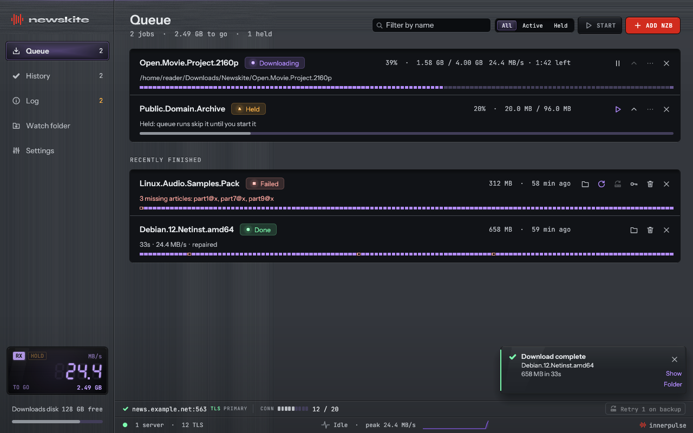
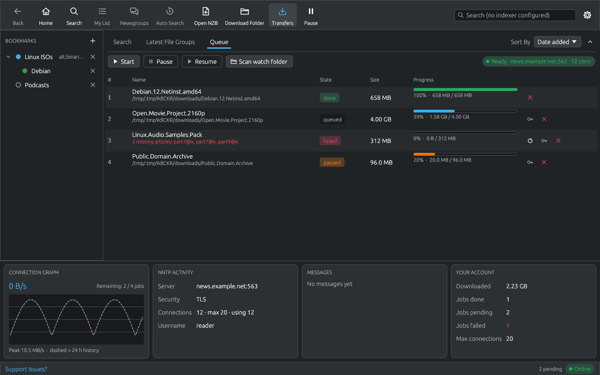
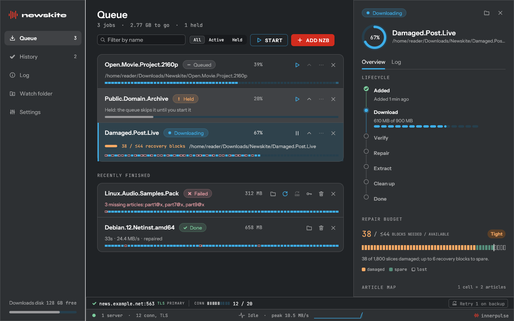
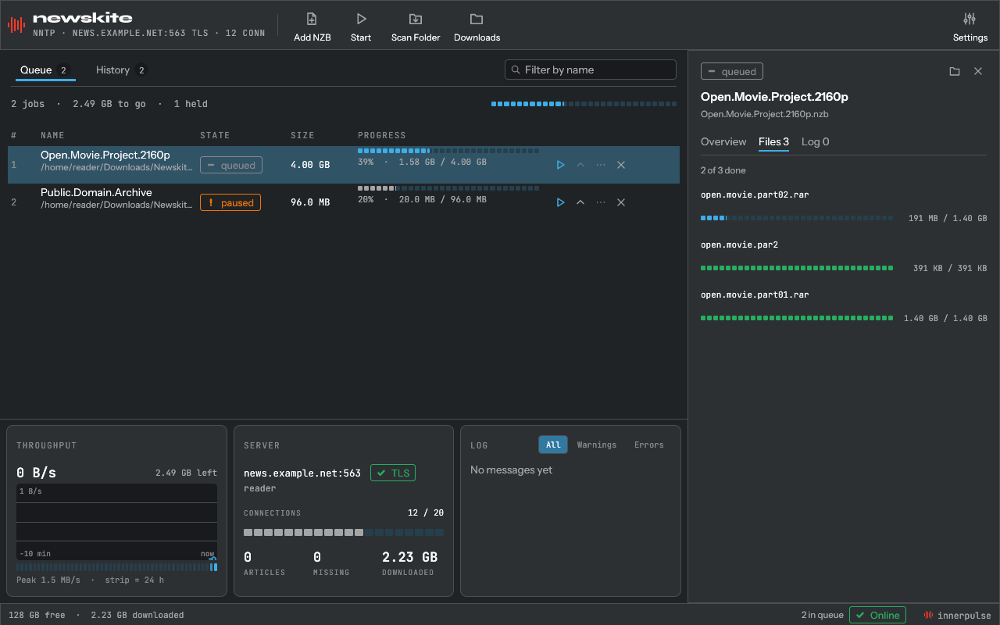

<p align="center">
  <picture>
    <source media="(prefers-color-scheme: light)" srcset="assets/brand/product/newskite-lockup-on-light.svg">
    <source media="(prefers-color-scheme: dark)" srcset="assets/brand/product/newskite-lockup-on-dark.svg">
    
  </picture>
</p>

# Newskite

Newskite is a desktop Usenet (NZB) download client written in Rust. You give it an NZB file;
it downloads the listed articles from your news server (NNTP, usually over TLS), decodes the
yEnc payloads, writes the original files to disk byte for byte, then verifies, repairs and
extracts them without any external program. It keeps a resumable, reorderable queue
where every job can be started, paused or moved on its own (drag a row to reorder), a download history, per-file
progress, a live map of every article (downloaded, missing, waiting) with a strip of it under each job, a filterable log and a
throughput graph in the status bar. It wears the innerpulse carbon look on Linux and Windows
alike (a brushed plate, keys of smoked glass, frosted sheets and a seven-segment throughput
display), with a warm ink, a paper theme and "follow the desktop's light or dark color
scheme" (KDE Plasma first) in Settings › Appearance.

Drop `.nzb` files (or a folder of them) onto the window, or copy them in the file manager
and press Ctrl+V. On Wayland the window runs through XWayland, because the windowing
library cannot receive dropped files natively there; set `NEWSKITE_WAYLAND=1` to keep
native Wayland (Ctrl+V and Add NZB still work).

The same queue engine also runs without a window: `newskite --headless` downloads NZBs from
a terminal or a script.

Newskite does not come with a Usenet server subscription, and it does not search or browse
Usenet: NZB files are the input (open them, drop them on the window, or use a watch folder).
You need an account with a news provider.

## Screenshots

These are the app's GUI snapshot tests (`crates/newskite-app/tests/snapshots/`), rendered
with sample jobs and the placeholder server `news.example.net`, so the names and figures are
test data, not a real download.

A download under way in the carbon look, which a new install wears:



The same queue following the desktop's dark or light color scheme (Settings › Appearance):

<picture>
  <source media="(prefers-color-scheme: light)" srcset="crates/newskite-app/tests/snapshots/populated-light.png">
  <source media="(prefers-color-scheme: dark)" srcset="crates/newskite-app/tests/snapshots/populated-dark.png">
  
</picture>

A damaged download in progress: the inspector shows each step of the job and how many
PAR2 recovery blocks the repair needs against how many are available.



The article map and per-file progress of a queued job:



## Architecture

The workspace is split into small crates with one job each. Arrows point from a crate to the
crates it depends on.

```
                        ┌──────────────────────────┐
                        │ newskite  (app binary)   │  egui/eframe window, launch args
                        └──┬─────────┬──────────┬──┘
                           │         │          │
               ┌───────────▼──┐  ┌───▼──────┐  ┌▼────────────────┐
               │ newskite-cli │  │ newskite │  │ newskite-theme  │  desktop color tokens
               │  (headless)  │  │ -service │◄─┤ (KDE/portal)    │
               └───────┬──────┘  └─┬──┬───┬─┘  └─────────────────┘
                       └──────────►│  │   │
                 ┌─────────────────┘  │   └────────────────┐
         ┌───────▼────────┐  ┌────────▼───────┐  ┌──────────▼────────┐
         │ newskite-engine│  │ newskite-store │  │ newskite-postproc │
         │ segment fetch, │  │ SQLite: jobs,  │  │ native par2, rar, │
         │ decode, writes │  │ settings, ...  │  │ 7z, zip, cleanup  │
         └──┬──────────┬──┘  └────────┬───────┘  └──────────┬────────┘
     ┌──────▼─────┐ ┌──▼───────────┐  │                     │
     │newskite-nzb│ │ newskite-nntp│  │                     │
     │ NZB + yEnc │ │ NNTP + TLS   │  │                     │
     └──────┬─────┘ └──┬───────────┘  │                     │
            └──────────┴──────────────┴──────────┬──────────┘
                                        ┌────────▼───────┐
                                        │ newskite-types │  settings, events, formatting
                                        └────────────────┘
```

| Crate | Role |
|---|---|
| `newskite-types` | Shared settings, server config, engine events, formatting helpers, default paths |
| `newskite-nzb` | NZB parser and yEnc decoder (byte-exact for all 256 byte values) |
| `newskite-nntp` | Async NNTP client (plain and TLS via rustls), plus a mock server used by tests |
| `newskite-engine` | Downloads one job: concurrent segment fetches, decoding, positioned writes, speed limit |
| `newskite-store` | SQLite persistence (bundled SQLite): jobs, files, bookmarks, throughput, settings |
| `newskite-par2` | Native PAR2 verify and repair (Reed-Solomon over GF(2^16)) |
| `newskite-postproc` | Post-processing: PAR2, native archive extraction (RAR, 7z, ZIP including spanned sets), cleanup |
| `newskite-service` | The queue shared by the GUI and the CLI: runs jobs, persists progress, watch folder, scheduler, auto-shutdown |
| `newskite-theme` | Reads the desktop color scheme (KDE `kdeglobals`, XDG portal, fallback) into color tokens |
| `newskite-cli` | Headless mode (`newskite --headless ...`) |
| `newskite` (`crates/newskite-app`) | The desktop application: egui/eframe GUI and launch-argument handling |

Stack: egui/eframe 0.33 (glow renderer), tokio, rustls (ring provider), rusqlite with bundled
SQLite.

## Building

Requirements:

- Rust 1.89 or newer (`rustup` recommended). The workspace MSRV is 1.89.
- A C compiler, for the bundled SQLite and the `ring` TLS crate.

On Debian, Ubuntu and Kubuntu that is all you need to build:

```sh
sudo apt install build-essential
cargo build --release -p newskite
```

No `-dev` packages are needed: the windowing libraries (Wayland, X11, xkbcommon, EGL/GL) are
loaded at run time, not linked at build time. To **run** the GUI, the system needs the usual
desktop libraries, which every desktop install already has: `libwayland-client0`,
`libwayland-cursor0`, `libwayland-egl1`, `libxkbcommon0`, `libxkbcommon-x11-0`, `libx11-6`,
`libxcursor1`, `libxrandr2`, `libxi6`, `libegl1` and `libgl1`. The `.deb` declares these as
dependencies.

Run the tests with `cargo test --workspace`. The packaging files have their own check script,
`packaging/tests/check-packaging.sh` (see [Packaging](#packaging)).

## Running

### Desktop app

```sh
cargo run --release -p newskite                  # open the window
newskite ~/Downloads/some-release.nzb            # open the window and queue an NZB
newskite file:///home/me/Downloads/a.nzb         # file:// and nzb:///path URIs work too
```

On first launch the empty queue leads with **Set up server**. Open Settings (that button,
the gear icon or `Ctrl+,`) and add your news server: host, port (563 for TLS, 119 without),
username, password and connection count. **Test** shows the server's actual reply. Then
import an NZB (Add NZB, `Ctrl+O`, or drag it onto the window) and press Start (it waits
until a server is set up).
With the window already open, opening an NZB from the file manager or an `nzb://` link
queues it there and brings the window forward.

Web links (`http(s)://`, `nzb://http...`, `nzblnk:`) are recognized but not fetched yet; the
app says so under the header and logs them as unsupported.

While a queue run is active the window title carries its progress and measured speed
(`42% · 12.4 MB/s · Newskite`), so a minimized window still says how it is going. An idle
window does not redraw: it wakes on input, on events and twice a minute.

#### Keyboard

| Keys | What they do |
|---|---|
| `Ctrl+O` | Choose NZB files |
| `Ctrl+V` | Add `.nzb` files copied in the file manager |
| `Ctrl+F` | Focus the name filter (the search, on the Log view) |
| `Ctrl+1` / `Ctrl+2` / `Ctrl+3` | Queue, History, Log |
| `Ctrl+,` | Settings; `Ctrl+S` there saves and closes |
| `↑` `↓` `Home` `End` | Walk the rows on screen |
| `Space` | Start, pause or retry the selected job |
| `Alt+↑` / `Alt+↓` | Move the selected job in the queue |
| `Delete` | Ask to remove the selected job; `Enter` confirms |
| `Esc` | Close one thing: a dialog, an inline editor or confirmation, then the selection |

On macOS the command key takes the place of `Ctrl`. Closing a Settings sheet with unsaved
changes asks before discarding them (Cancel discards at once).

Motion (the beating mark, drifting edges, fades) stops when the desktop asks for reduced
motion (KDE's animation speed set to instant), with `NEWSKITE_REDUCED_MOTION=1`, or with
**Reduce motion** in Settings › Appearance.

### Headless CLI

```sh
# Download with an explicit server (not saved to the settings):
NEWSKITE_PASS='secret' newskite --headless \
    --nzb ~/Downloads/a.nzb --dest ~/Downloads/Newskite \
    --server news.example.com:563 --tls --user alice --connections 20

# Several NZBs, using the server saved in the app's settings:
newskite --headless --nzb one.nzb --nzb two.nzb

# Use a separate database folder (for scripts and testing):
newskite --headless --db /tmp/nk-db --nzb a.nzb --server [::1]:119
```

It prints one `queued <name>` line per NZB, then `complete <name>` or `failed <name>: <reason>`
for each job. Exit codes: `0` when every job of the run completed, `1` when any failed, `2`
for usage errors (including "no usable server"), `130` after Ctrl-C (unfinished jobs stay
queued and resume on the next run). Prefer `NEWSKITE_PASS` over `--pass`, because command-line
arguments are visible to other users in the process list. `newskite --headless --help` lists
every option.

## Where data is stored

Everything lives in one SQLite database. On Linux that is
`~/.local/share/newskite/db/newskite.sqlite3` (the `db` folder under the platform data
directory; on Windows and macOS it is under the usual per-user application data folder).
The headless `--db DIR` option points it elsewhere. Only one Newskite process can use a
data directory at a time: while the GUI is running, a headless run on the same directory
exits with an "another Newskite instance" error instead of touching the GUI's queue.

## Credential storage

Newskite does not use the system keyring and does not encrypt anything it stores. On Linux
and macOS the database files are created readable only by you (mode `0600`, and a data
directory Newskite creates is `0700`), but anyone with access to your account, root, or a
backup of the files, or anyone who can watch your processes, can recover these:

- **Server passwords** are stored unencrypted: the settings, including every server's
  username and password, are kept as plain JSON in the `settings` table of the database in
  `~/.local/share/newskite/db`.
- **Archive passwords** you enter for a job are stored in plain text with that job (the `jobs`
  table). Extraction is built in, so the password never leaves the Newskite process: it is
  kept in memory while an archive is extracted and never handed to another program or put on
  a command line.
- **Headless CLI:** prefer the `NEWSKITE_PASS` environment variable over `--pass`, because a
  password given on the command line is visible to other users in the process list. Passwords given with `--server`/`--pass`/`NEWSKITE_PASS` are kept only in
  memory and never written to the database.

Passwords are never written to the message log.

## Post-processing

PAR2 verify/repair and RAR, 7z and ZIP extraction (including split volumes, spanned
`.z01` ... `.zip` sets and passwords) are built into Newskite. It never starts an external
program, so `par2`, `7z`, `unrar` and `unzip` are not needed and not used even when they are
installed. A download with missing articles is still repaired when its PAR2 data covers the
gap. An archive that uses a feature the built-in extraction does not support (a rare codec)
fails with a message naming it; a PAR2 set whose main packet cannot be read is reported as
unverified, and extraction still runs and checks the archive's own checksums.

Building from source compiles the bundled UnRAR library, so a C++ compiler (`g++` or
`clang++`) is needed.

## Packaging

All packaging files are in [`packaging/`](packaging):

| File | Purpose |
|---|---|
| `net.innerpulse.Newskite.desktop` | Desktop entry; registers `application/x-nzb`, `nzb:` and `nzblnk:` |
| `net.innerpulse.Newskite.metainfo.xml` | AppStream metadata for software centers |
| `mime/newskite-nzb.xml` | shared-mime-info type `application/x-nzb` (`*.nzb` glob and `<nzb` magic) |
| `icons/net.innerpulse.Newskite.svg` | Scalable app icon |
| `icons/hicolor/<size>/apps/*.png` | PNG renders at 16, 24, 32, 48, 64, 128, 256 and 512 px |
| `icons/light/` | The same set on a light (paper) tile, for light docks and launchers |
| `icons/make-icons.mjs` | Generates every icon file above (see [Brand](#brand)) |
| `build-appimage.sh` | Builds an AppDir and, with `appimagetool`, an `.AppImage` |
| `install-local.sh` / `uninstall-local.sh` | Per-user install into `~/.local` without root |
| `tests/check-packaging.sh` | Validates all of the above in a temporary directory |
| `windows/newskite.iss` | Inno Setup script for the Windows installer |

The application id is `net.innerpulse.Newskite` everywhere: desktop file name, icon name,
AppStream id and the Wayland `app_id` / X11 `WM_CLASS` the window sets.

### Release packages (GitHub)

[`.github/workflows/release.yml`](.github/workflows/release.yml) builds every package on
GitHub Actions: a Windows installer and zip (`windows-2022`), and a `.deb` and AppImage
(`ubuntu-22.04`, so they run on glibc 2.35 and newer). Each run tests first. Pull requests
and manual runs (Actions → Packages → Run workflow) attach the packages to the run as
artifacts; pushing a tag that matches the workspace version publishes a GitHub Release:

```sh
git tag v1.5.0 && git push origin v1.5.0
```

### Windows

Download `Newskite-<version>-windows-x64-setup.exe` from the release (or the workflow run's
artifacts). The installer needs no administrator rights: it installs for the current user
under `%LOCALAPPDATA%\Programs\Newskite` (its first page offers an all-users install), adds
a Start menu entry, and opens `.nzb` files and `nzb:` links with Newskite. The `.zip` holds
the same `newskite.exe` for running without installing. Either way the queue, settings and
database live in `%APPDATA%\innerpulse\Newskite`, which uninstalling keeps.

The packages are not code-signed, so the first run shows a SmartScreen prompt ("Windows
protected your PC"): choose **More info → Run anyway**.

`newskite.exe` is a windowed program; `newskite --headless ...` still prints to the
terminal it is typed in, but the prompt returns at once. To wait for a headless run, use
`start /wait newskite --headless ...` in `cmd` or `Start-Process -Wait` in PowerShell.

To build the installer by hand on Windows (Rust and [Inno Setup](https://jrsoftware.org/isinfo.php) installed),
follow the steps in the workflow's `windows` job.

### Debian package (.deb)

```sh
cargo install cargo-deb --locked     # once
cargo deb -p newskite
# -> target/debian/newskite_1.5.0-1_amd64.deb
sudo apt install ./target/debian/newskite_1.5.0-1_amd64.deb
```

The metadata is in `[package.metadata.deb]` in `crates/newskite-app/Cargo.toml`. The package
installs the binary to `/usr/bin/newskite` plus the desktop entry, AppStream file, MIME type
and icons under `/usr/share` and depends on the windowing libraries listed above; it needs no
post-processing tools. The glibc dependency comes from the build machine, so build on the
oldest release you want to support.

### AppImage

```sh
packaging/build-appimage.sh                  # builds the binary, AppDir and AppImage
packaging/build-appimage.sh --appdir-only    # stop after the AppDir
```

The script never downloads anything. If `appimagetool` is not installed it leaves the AppDir
in `target/appimage/Newskite.AppDir`, prints where to get the tool, and exits with status 3.
Put `appimagetool` on `PATH` (or set `APPIMAGETOOL=/path/to/appimagetool`) and run
`packaging/build-appimage.sh --no-build`.

### Per-user install

```sh
packaging/install-local.sh          # binary to ~/.local/bin, desktop/MIME/icons to ~/.local/share
packaging/uninstall-local.sh        # removes exactly those files; keeps your data and downloads
```

`install-local.sh` refreshes the desktop, MIME and icon caches and makes Newskite the default
handler for `.nzb` files and `nzb:`/`nzblnk:` links (`--no-default` skips that). See `--help`
on each script for the options.

### Regenerating the icons

The icons are generated, not hand-drawn; see [Brand](#brand) for the command.

## Platform status

- **Linux:** the primary target, developed on Kubuntu (KDE Plasma). The test suite covers the
  engine end to end against a local NNTP server and renders the GUI offscreen; the packaged
  window still needs hands-on testing on Wayland and X11 sessions. Desktop theme detection
  reads KDE's `kdeglobals` and the XDG desktop portal.
- **Windows 10 (1809) and 11, x64:** built and unit-tested on every release run, with an
  installer. A second launch (a double-clicked `.nzb`) hands its files to the open window
  over a loopback port guarded by a per-run token. The window wears the same carbon look as on
  Linux; with "Follow desktop" chosen it follows Windows' light/dark setting through the
  toolkit. "Show in folder" selects the file in Explorer. Finished-queue desktop
  notifications are not shown yet (the in-window toasts are).
  The GUI snapshot tests run on Linux only.
- **macOS:** the code is written to compile there (platform-specific code is behind `cfg`,
  paths come from the `directories` crate), but it has not been built or tested, and there
  is no package.

## License

Licensed under either of the [MIT license](LICENSE-MIT) or the
[Apache License, Version 2.0](LICENSE-APACHE), at your option (`MIT OR Apache-2.0`, as
declared in `Cargo.toml`).

The binary also includes the UnRAR library by Alexander Roshal, which reads RAR archives
under its own freeware license: it may be redistributed freely, but its code may not be used
to create RAR archives or to rebuild the RAR compression algorithm. The full text is in
[`packaging/debian/copyright`](packaging/debian/copyright); the `.deb` installs it as
`/usr/share/doc/newskite/copyright` and the AppImage carries it at the same path inside.

## Brand

Newskite is an [innerpulse](https://innerpulse.net) product.

The app icon is the stock innerpulse app icon at every size: the ink (carbon) tile and the
six-bar mark. Following the brand's rule for desktop apps, the product's violet accent appears inside
the app, not in the icon. The kit's whole-pixel renders keep the small sizes sharp.

- `assets/brand/product/`: the Newskite wordmark and horizontal lockups (on dark and on light)
  and the social card.
- `assets/brand/kit/`: the stock innerpulse mark, app icons and UI icons, copied from the
  brand kit.
- `assets/brand/fonts/`: the brand typefaces (Instrument Sans, JetBrains Mono).
- `assets/brand/fonts/OFL.txt`: the fonts' copyright notices and license (SIL OFL 1.1). The
  fonts are embedded in the binary, so the packages install this file as
  `/usr/share/doc/newskite/fonts-OFL.txt`, with a machine-readable `packaging/debian/copyright`.
- `assets/brand/app-icon-256.png`: the 256 px app icon, a copy of the hicolor render.
- `packaging/icons/`: the installed app icons and `preview.png`, a contact sheet of every size.

Every icon is checked in, so building and packaging Newskite needs nothing beyond this
repository. Regenerating them needs the innerpulse brand kit, which is the studio's own and
is not published; with it at hand (ImageMagick, when installed, redraws `preview.png`):

```sh
BRAND_KIT=/path/to/brand-kit node packaging/icons/make-icons.mjs
packaging/tests/check-packaging.sh
```
